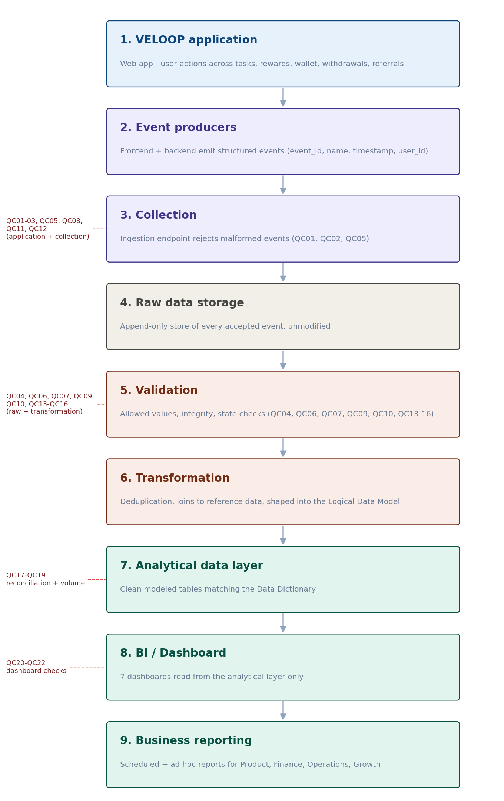
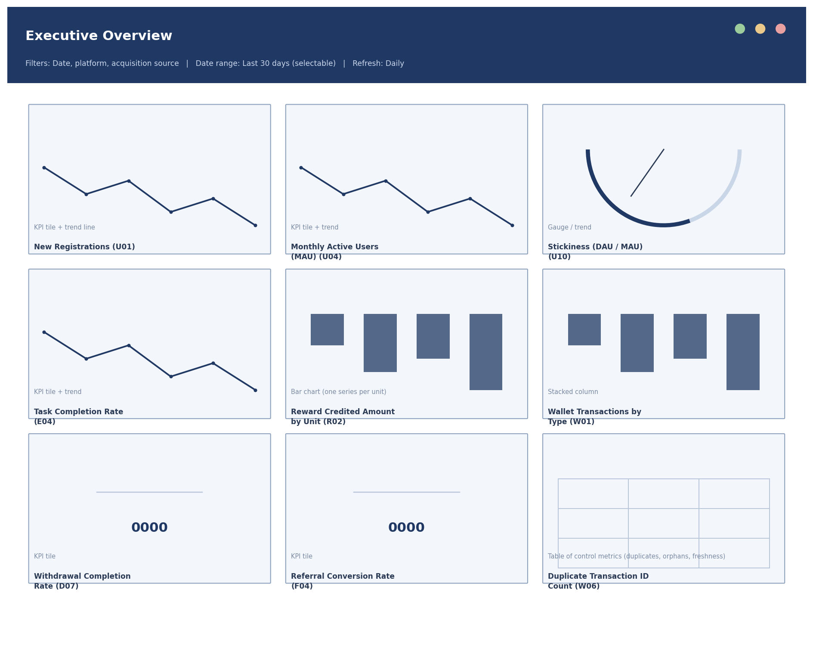

# VELOOP Rewards - Product Analytics, Data Readiness & Data Management Blueprint

Data Analyst Internship, Task 01 | Version 0.2 | Author: Subhojeet Ganguli

> **Data authenticity notice.** The only dataset supplied for this task is **simulated / fictional**. Every figure in this repository describes that simulated data and **not** actual VELOOP users, earnings, withdrawals, revenue, retention, conversion or performance. Anything that could not be verified is marked *Proposed* or *To Be Verified*.

## What this project is

VELOOP Rewards is a developing rewards and engagement product without production data yet. This project builds the analytics foundation it will need: what to collect, how to structure it, how to check that it can be trusted, what to measure, and what engineering must implement.

## Live dashboard

- Live:(https://vercel.com/new/subhojeet-ganguli/success?auto-redirect=true&developer-id=&external-id=&redirect-url=&branch=main&deploymentUrl=veloop-data-analyst-task01-tyer-2x8j034zh-subhojeet-ganguli.vercel.app&projectName=veloop-data-analyst-task01-tyer&s=https%3A%2F%2Fgithub.com%2FSubhojeetGanguli%2Fveloop-data-analyst-task01&gitOrgLimit=&hasTrialAvailable=1&totalProjects=1&flow-id=jigji5_7FvrmL34e63i-I&teamSlug=subhojeet-ganguli)
- Local: open [`index.html`](index.html) in any browser. It is fully self-contained (the chart library is embedded), so it also works offline.

A working, filterable User Analytics dashboard computed from the simulated Users dataset (1,000 records): 4 filters, 7 KPI tiles, 7 charts and an insights panel. It covers the user-level view only; the other six dashboards in the blueprint are specified but not built, because the supplied data contains only the Users sheet.

## Repository contents

| # | Deliverable | File |
|---|---|---|
| 01 | Executive Summary | [reports/VELOOP_01_Executive_Summary.docx](reports/VELOOP_01_Executive_Summary.docx) |
| 02 | Product Data Audit | [reports/VELOOP_02_Product_Data_Audit.docx](reports/VELOOP_02_Product_Data_Audit.docx) |
| 03 | Data Coverage Matrix | [workbooks/VELOOP_Analytics_Design_Workbook.xlsx](workbooks/VELOOP_Analytics_Design_Workbook.xlsx) - sheet `Coverage_Matrix` |
| 04 | User Analytics Specification | same workbook - sheet `User_Analytics_Spec` |
| 05 | Earning & Reward Analytics | [specifications/VELOOP_05_Earning_Reward_Analytics_Specification.docx](specifications/VELOOP_05_Earning_Reward_Analytics_Specification.docx) |
| 06 | Wallet & Withdrawal Analytics | [specifications/VELOOP_06_Wallet_Withdrawal_Analytics_Specification.docx](specifications/VELOOP_06_Wallet_Withdrawal_Analytics_Specification.docx) |
| 07 | Referral & Engagement Analytics | [specifications/VELOOP_07_Referral_Engagement_Analytics_Specification.docx](specifications/VELOOP_07_Referral_Engagement_Analytics_Specification.docx) |
| 08 | Event Tracking Plan (43 events) | design workbook - sheet `Event_Plan` |
| 09 | Data Dictionary (124 fields) | design workbook - sheet `Data_Dictionary` |
| 10 | Logical Data Model (ER diagram) | [diagrams/er-diagram.html](diagrams/er-diagram.html) |
| 11 | KPI Catalogue (52 KPIs) | design workbook - sheet `KPI_Catalogue` |
| 12 | Simulated Data Profiling | [workbooks/VELOOP_Simulated_Data_Profiling_and_DQ_Audit.xlsx](workbooks/VELOOP_Simulated_Data_Profiling_and_DQ_Audit.xlsx) |
| 13 | Data Quality Audit (19 issues) | profiling workbook - sheet `DQ_Issue_Log` |
| 14 | Dashboard Blueprint + wireframes | [diagrams/VELOOP_14_Dashboard_Wireframes.docx](diagrams/VELOOP_14_Dashboard_Wireframes.docx) and design workbook - sheet `Dashboard_Blueprint` |
| 15 | Developer Analytics Handoff (29 events) | design workbook - sheet `Dev_Handoff` |
| 16 | Data Pipeline Proposal | [specifications/VELOOP_16_Data_Pipeline_Proposal.docx](specifications/VELOOP_16_Data_Pipeline_Proposal.docx) |
| 17 | Privacy & Governance Proposal | [specifications/VELOOP_17_Privacy_Governance_Proposal.docx](specifications/VELOOP_17_Privacy_Governance_Proposal.docx) |
| 18 | Analytics Readiness Assessment | design workbook - sheet `Readiness` |
| 19 | Assumption & Verification Register (30 items) | design workbook - sheet `Assumptions` |
| 20 | Implementation Backlog (28 items) | design workbook - sheet `Backlog` |
| 21 | Final Consolidated Report | [reports/VELOOP_21_Final_Consolidated_Report.docx](reports/VELOOP_21_Final_Consolidated_Report.docx) |

## Pipeline architecture (proposed)

## Dashboard wireframe example

## Key findings (simulated data)

1. **95 accounts marked "Inactive" are flagged active in the last 30 days.** The flags equal "last login within 7 / 30 days of 15 Sep 2026" for all 1,000 users and ignore account status. VELOOP needs one written definition of "active".
2. **119 users were acquired through referral, but no field identifies who referred them.** The referral funnel cannot be measured until that link exists.
3. **40 accounts are Active while consent is still Pending**, which is a governance risk.

The full list of 19 data-quality issues, with detection logic, cause, correction and prevention, is in the profiling workbook.

## How the work was checked

- Every figure in the documents was compared with the source data; errors found were corrected and logged in the workbook's `Change_Log` sheet.
- The dashboard was tested across all 3,600 filter combinations against an independent calculation, and in a real browser (light and dark mode, 375px phone width, zero-result and chart-library-failure cases).
- All Word files pass schema validation, and the ER diagram was rendered and inspected in a browser.

## Limitations

- Only the **Users** dataset was available. Task Activity, Rewards, Wallet, Withdrawals, Referrals and Feature Events were not supplied, so cross-dataset relationship tests and most KPI tests are marked *not testable* rather than invented.
- All events, fields and KPIs beyond the Users sheet are **Proposed** until Engineering and Product verify them (see the Assumption Register).
- When production data exists, it should replace the simulated data and must never be mixed with it silently.

## Deploying the dashboard (optional)

The dashboard is a single static page, so no build step is needed.

- **Netlify:** drag the repository folder into [app.netlify.com/drop](https://app.netlify.com/drop), or import the GitHub repo. Leave the build command empty and the publish directory as the root.
- **Vercel:** import the GitHub repo, choose "Other" as the framework, and deploy. `index.html` in the root is served automatically.

## Use of AI assistance

An AI assistant helped draft and check parts of this work. I reviewed the content, and I can explain any section.

## Data handling

The original source workbook (with fictional names and emails) is deliberately **not** included. The dashboard embeds only analytical fields: no names, emails or exact ages. No passwords, API keys or credentials appear anywhere in this repository.
